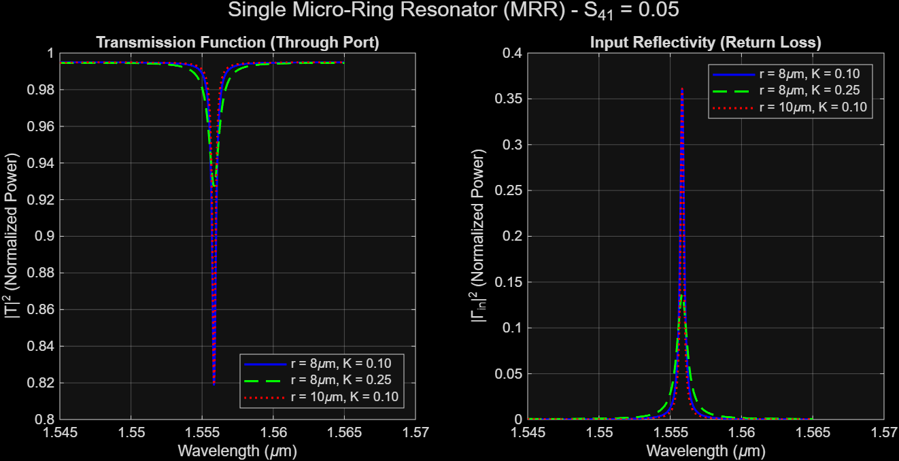
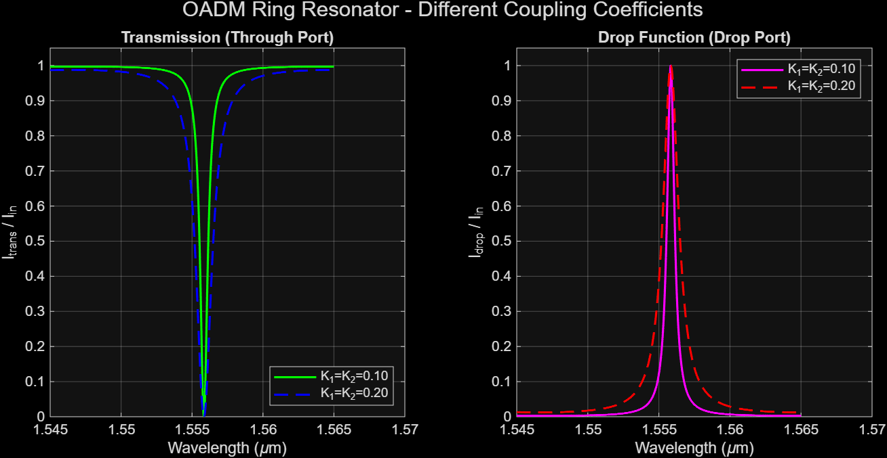

# Micro-Ring Resonator (MRR) & OADM Spectral Simulation

Theoretical modeling and numerical simulation in **MATLAB** of a **Single-Bus Micro-Ring Resonator (MRR)** and an **Optical Add-Drop Multiplexer (OADM)** based on the **Scattering Matrix (S-matrix)** formalism.

> **Course:** Passive Optical Components (Politecnico di Torino) 
> **Author:** Lorenzo Pellegrino

---

## Overview

Instead of relying on coupled-mode differential equations, the directional coupling regions are modeled as 4-port optical devices. Closed-loop boundary conditions are applied to evaluate steady-state interference, spectral response, and key figures of merit around the C-band ($\lambda \approx 1.555\ \mu\text{m}$).

### Key Features
* **Single-Bus MRR with Non-Ideal Isolation ($S_{41} \neq 0$):** Incorporates realistic back-reflection in the coupling region ($S_{41} = 0.05$) while enforcing energy conservation ($t = \sqrt{1 - C^2 - S_{41}^2}$), enabling the evaluation of input **Return Loss** ($\vert{}\Gamma_{\text{in}}\vert{}^2$) alongside **Through-port Transmission** ($\vert{}T\vert{}^2$).
* **Parametric Sweep:** Evaluates spectral shifts and resonance broadening across varying ring radii ($r = 8\ \mu\text{m}, 10\ \mu\text{m}$) and power coupling coefficients ($K = 0.10, 0.25$).
* **OADM Extension:** Cascades two directional couplers ($K_1, K_2$) to simulate multi-port routing (**Through** notch filtering and **Drop** bandpass filtering).
* **Figures of Merit Extraction:** Automatically computes Free Spectral Range (**FSR**), Full Width at Half Maximum (**FWHM**), and Quality Factor (**Q**).

---

## Simulation Results

### 1. Single-Bus Micro-Ring Resonator ($S_{41} = 0.05$)
Comparison of Through-port transmission and input reflectivity for different coupling strengths and cavity radii:



### 2. Optical Add-Drop Multiplexer (OADM)
Through and Drop port normalized power spectra for symmetric coupling configurations ($K_1 = K_2 = 0.10$ vs. $K_1 = K_2 = 0.20$):



### Baseline Performance Metrics ($r = 8\ \mu\text{m}$, $K_1 = K_2 = 0.10$, $n_{\text{eff}} = 2.6$)

| Parameter | Symbol | Simulated Value |
| :--- | :---: | :---: |
| **Resonance Wavelength** | $\lambda_{\text{res}}$ | $1555.835\ \text{nm}$ |
| **Free Spectral Range** | $\text{FSR}$ | $18.52\ \text{nm}$ |
| **Full Width at Half Maximum** | $\text{FWHM}$ | $621.46\ \text{pm}$ |
| **Quality Factor** | $Q$ | $2504$ |

---

## Getting Started

### Prerequisites
* **MATLAB** (R2020b or newer recommended; no external toolboxes required)

### Usage
1. Clone the repository:
   ```bash
   git clone https://github.com/<your-username>/microring-resonator-smatrix-simulation.git
   cd microring-resonator-smatrix-simulation
   ```
2. Open MATLAB, navigate to the `src/` folder, and run:
   ```matlab
   mrr_oadm_simulation
   ```
3. The script will generate both spectral comparison plots and print the extracted OADM metrics in the Command Window.

---

## Repository Structure

* `src/mrr_oadm_simulation.m` — Main MATLAB script containing parametric sweeps and local solver functions (`simulate_single_MRR`, `simulate_OADM`).
* `results/` — High-resolution output figures generated by the simulation.
* `docs/Assignment_5_Report.pdf` — Detailed mathematical derivation and physical analysis report.

---

## References
* P. Steglich *et al.*, "Silicon Photonic Micro-Ring Resonators for Chemical and Biological Sensing: A Tutorial," *IEEE Sensors Journal*, vol. 22, no. 11, pp. 10089–10105, June 1, 2022, doi: [10.1109/JSEN.2021.3119547](https://doi.org/10.1109/JSEN.2021.3119547).
